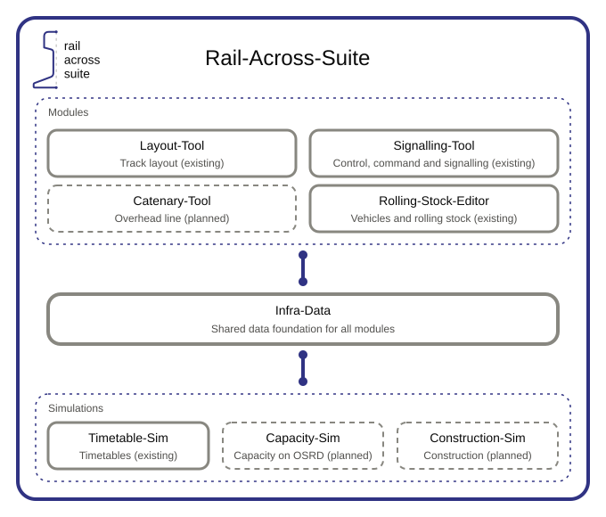

# Rail-Across-Suite

*Railway planning across disciplines* — a modular open-source toolkit for railway infrastructure planning, built
around a shared data core. Short form: Rail-Across. Projects are exchanged as `.railacross` files.

## Repository

One repository holds the core, every module and the server
([decision 0001](docs/decisions/0001-one-repository.md)):

| Directory | Content |
|---|---|
| `packages/` | the Rail-Data-Core (JavaScript and Python) and the libraries the apps and the server share (point clouds, the suite's look `ui`) |
| `schemas/` | JSON Schema per domain, shared test vectors |
| `apps/` | the modules: the suite's start page, the Layout-Tool, the Signalling-Tool, the Simulation-Tool, the Fahrzeug-Editor, the Fahrplan-Editor |
| `server/` | the project server for all modules |
| `sim/`, `crossover/`, `optimizer/` | Rust, built to WebAssembly for the browser: the running time simulation, the search of the extended switch connection, the track optimizer — splicing, reconnecting, optimizing, the alignment fit ([decision 0019](docs/decisions/0019-optimizer-in-rust.md)) |
| `docs/` | data model, decisions, glossary, conventions |
| `tools/` | repository checks (`npm run check`) |

The JavaScript parts — apps, packages and the server — are one npm workspace: `npm install` at the root installs
them all, `npm run check` checks the repository's rules. Data kept out of the history is fetched per app
([decision 0008](docs/decisions/0008-data-outside-history.md)), for the Layout-Tool with `npm run data` in
`apps/layout-tool/`.

How to contribute: [CONTRIBUTING.md](CONTRIBUTING.md).

The project was called Open-Rail-Designer until it was renamed ([decision 0007](docs/decisions/0007-project-name.md)).

## Roadmap

The [roadmap](ROADMAP.md) starts with the Rail-Data-Core; how its data is structured and stored is proposed in
[docs/data-model.md](docs/data-model.md).

## Licence

Copyright 2026 Serigalan and the Rail-Across-Suite contributors; the simulation core in `sim/` and OSRD's
example vehicles also 2022 The OSRD Contributors.

- **Everything** — code, schemas, documentation, `architecture.svg` — under the
  [GNU Lesser General Public License v3.0 only](LICENSE) (`LGPL-3.0-only`), which builds on the
  [GNU General Public License v3.0](LICENSE-GPL) — the licence of OSRD, whose simulation core the suite carries
  ([decision 0015](docs/decisions/0015-lgpl.md)).
- **Third-party material** keeps its own licence, listed in [THIRD-PARTY.md](THIRD-PARTY.md).

Contributions are made under this licence and signed off (`Signed-off-by:`) after the
[Developer Certificate of Origin](https://developercertificate.org/).
