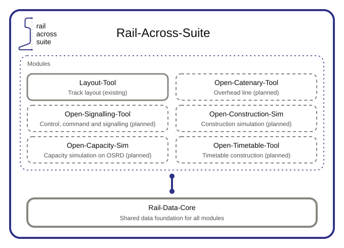

# Rail-Across-Suite

*Railway planning across disciplines* — a modular open-source toolkit for railway infrastructure planning, built
around a shared data core. Short form: Rail-Across. Projects are exchanged as `.railacross` files.

## Repository

One repository holds the core, every module and the services
([decision 0001](docs/decisions/0001-one-repository.md)):

| Directory | Content |
|---|---|
| `packages/` | the Rail-Data-Core (JavaScript and Python) and the libraries the apps and the server share (point clouds) |
| `schemas/` | JSON Schema per domain, shared test vectors |
| `apps/` | the modules, starting with the Open-Layout-Tool |
| `server/` | the project server for all modules |
| `services/` | the Python services |
| `docs/` | data model, decisions, glossary, conventions |
| `tools/` | repository checks (`npm run check`) |

The JavaScript parts — apps, packages and the server — are one npm workspace: `npm install` at the root installs
them all, `npm run check` checks the repository's rules. Data kept out of the history is fetched per app
([decision 0008](docs/decisions/0008-data-outside-history.md)), for the Open-Layout-Tool with `npm run data` in
`apps/open-layout-tool/`.

How to contribute: [CONTRIBUTING.md](CONTRIBUTING.md).

The project was called Open-Rail-Designer until it was renamed ([decision 0007](docs/decisions/0007-project-name.md)).

## Roadmap

The [roadmap](ROADMAP.md) starts with the Rail-Data-Core; how its data is structured and stored is proposed in
[docs/data-model.md](docs/data-model.md).

## Licence

Copyright 2026 Serigalan and the Rail-Across-Suite contributors.

- **Code** — everything that is not documentation, including the schemas — under the
  [Apache License 2.0](LICENSE) (`Apache-2.0`).
- **Documentation** — `README.md`, `ROADMAP.md`, the `README.md` files in the directories, everything in `docs/`
  and `architecture.svg` — under [Creative Commons Attribution 4.0 International](LICENSE-docs) (`CC-BY-4.0`).
- **Third-party material** keeps its own licence, listed in [THIRD-PARTY.md](THIRD-PARTY.md).

Contributions are made under these licences and signed off (`Signed-off-by:`) after the
[Developer Certificate of Origin](https://developercertificate.org/).
